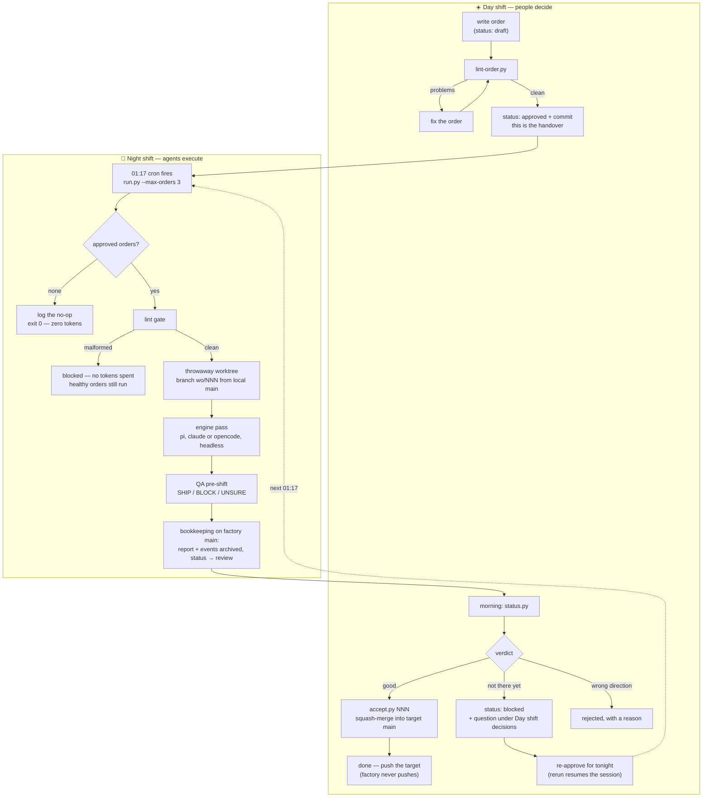
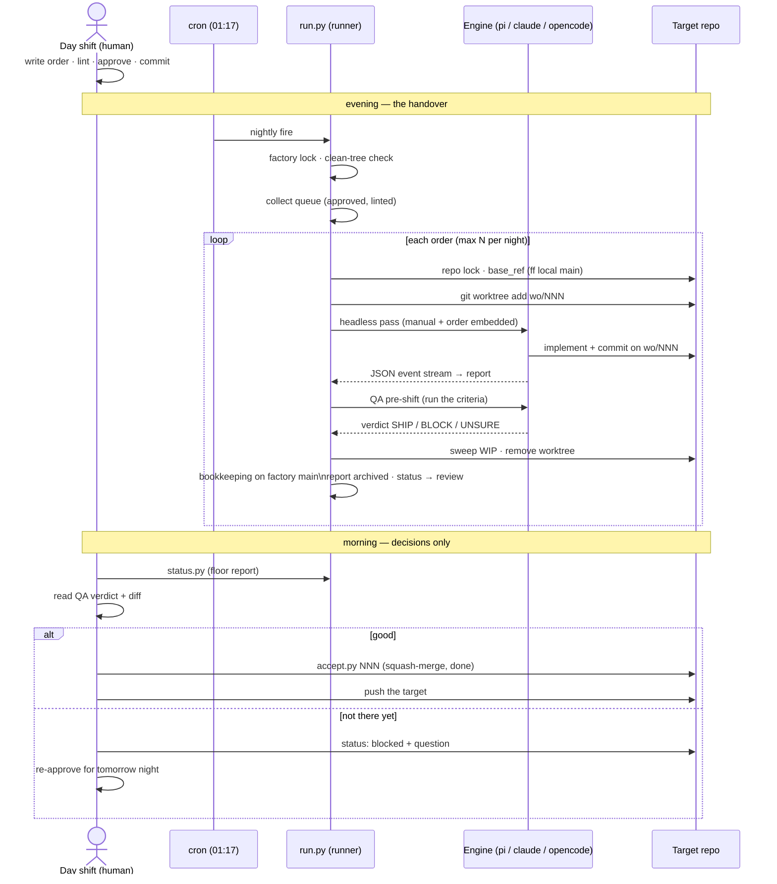

# How work flows through the factory

Two views of the same loop: a **flowchart** of the work-order lifecycle
(who may do what), and a **sequence diagram** of one full day/night cycle.

## Flowchart — the work-order lifecycle

## Sequence diagram — one full day/night cycle

## The invariants both diagrams rely on

- Only the **day shift** moves work into or out of `approved`, `blocked`,
  `done`, `rejected` — and only the day shift merges or pushes.
- The **night shift** never touches a working copy: every order runs in a
  throwaway worktree on its own branch.
- Blocked or ambiguous → the night **stops and asks**; it never guesses.
